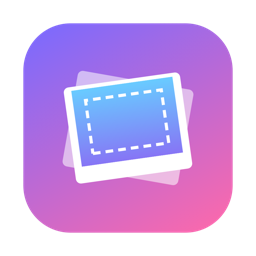
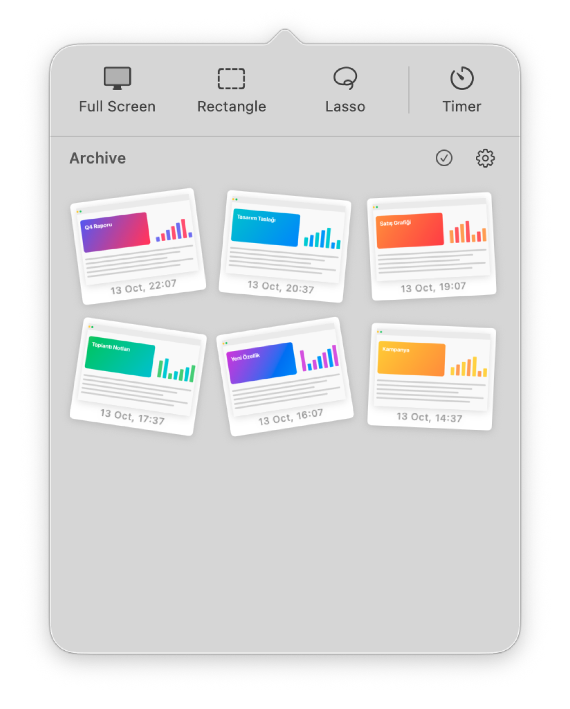
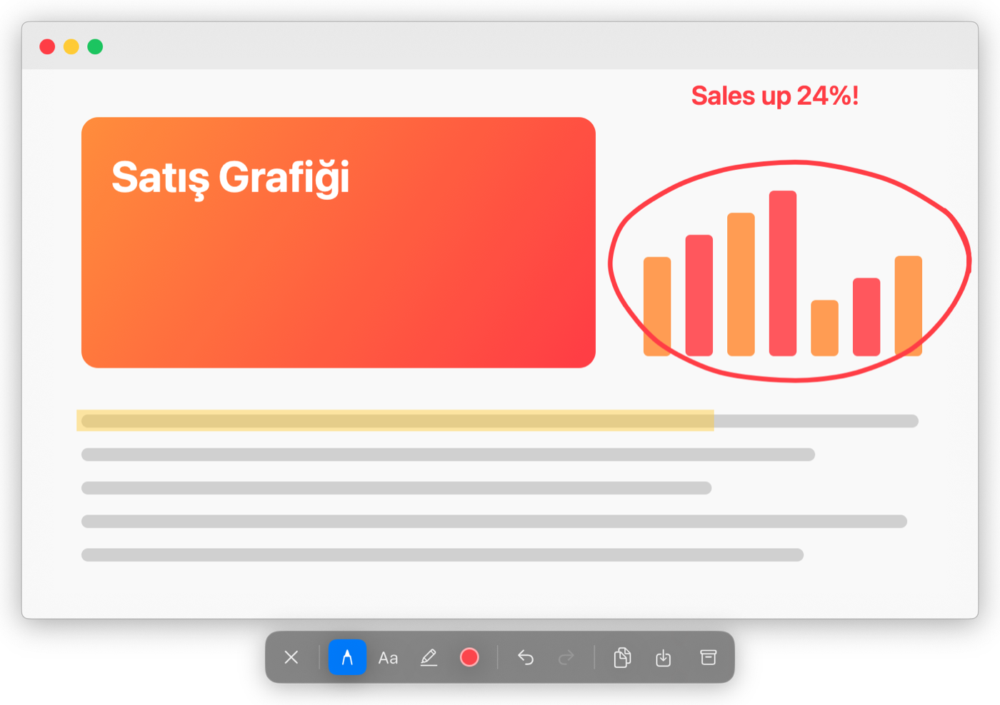
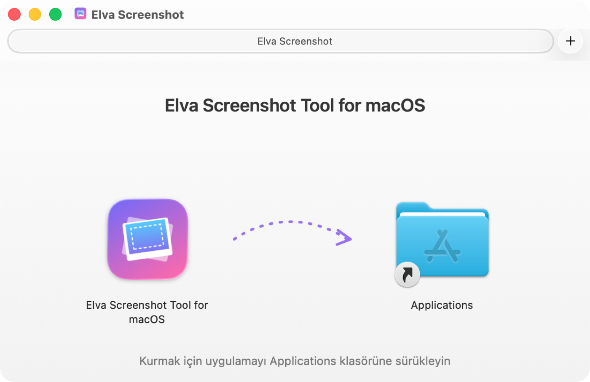
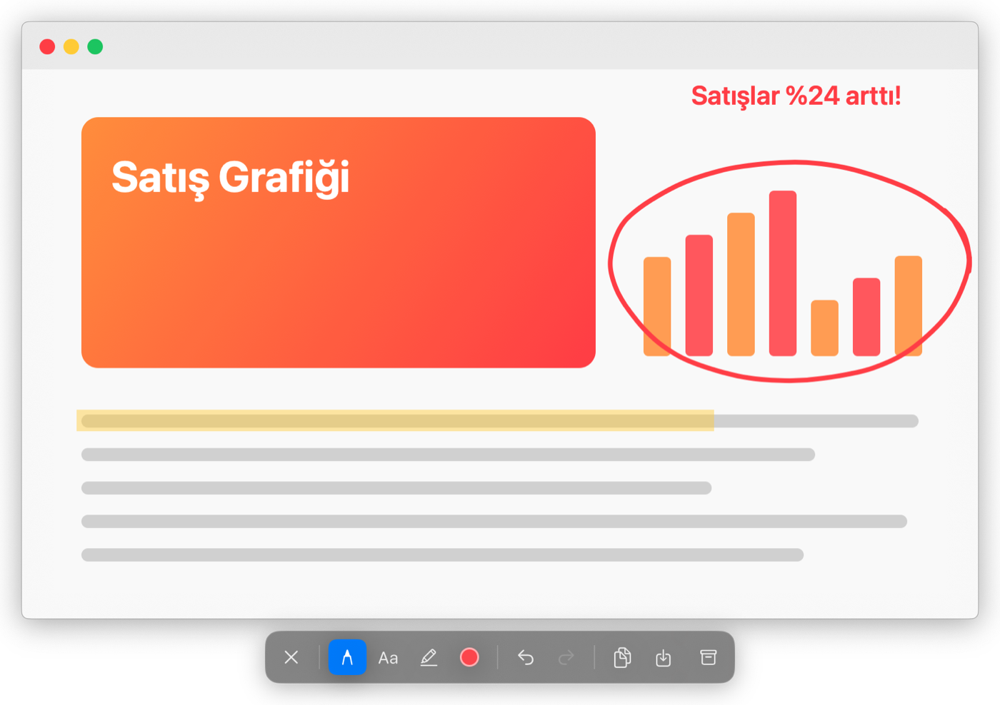

  

<h1 align="center">Elva Screenshot Tool for macOS</h1>

  <a href="https://github.com/qokalp/elva-macos-screenshot/releases/latest/download/Elva-Screenshot.dmg"><b>⬇︎ Download / İndir (DMG)</b></a>
  &nbsp;·&nbsp; macOS 14 Sonoma+

  <a href="#english"><b>English</b></a> &nbsp;|&nbsp; <a href="#turkce"><b>Türkçe</b></a>

---

# English

A simple, fast screenshot tool for your Mac.
Capture your whole screen or just the part you need, draw, write and highlight on it, and keep it in your archive.

  
  &nbsp;&nbsp;
  

Elva speaks **English and Turkish**. It automatically uses your Mac's language (Turkish if your Mac is set to Turkish, English otherwise).

## What can you do?

- 📸 **Three ways to capture:** the whole screen, a rectangle, or a free-hand (lasso) shape
- ⏱️ **Timer:** capture automatically after 3, 5 or 10 seconds
- ✏️ **Draw on it:** pen, text and highlighter
- 📋 **Share in one click:** copy, save as PNG/JPG, or archive
- 🗂️ **A good-looking archive:** all your screenshots in the menu bar, laid out like Polaroid photos
- ⌨️ **Keyboard shortcuts:** capture without opening the menu

## Installation

1. Click the **“Download”** link at the top of this page.
2. Double-click the downloaded **Elva-Screenshot.dmg** file.
3. In the window that opens, drag the Elva icon onto the **Applications** folder.

   

4. Open **Elva Screenshot Tool for macOS** from your Applications folder.
   Elva lives in the menu bar: it doesn't appear in the Dock. Instead, a camera icon shows up at the top right of your screen.

> The first time you open it, macOS asks whether you're sure you want to open an app downloaded from the internet. Click **Open**. Elva is signed and notarized by Apple.

### Screen recording permission

macOS asks for permission before any app can take screenshots. On your first capture:

1. Click **Open System Settings** in the window that appears.
2. In the **Screen & System Audio Recording** list, turn on the switch next to Elva.
3. Quit and reopen Elva (menu bar icon › ⚙︎ › Quit Elva, then open it again from Applications).

## User guide

### Taking a screenshot

Click the **camera icon** in the menu bar. You'll see four buttons at the top:

| Button | What it does |
|---|---|
| **Full Screen** | Captures the whole screen your mouse is on. |
| **Rectangle** | The screen dims; drag with the mouse to select a rectangular area. |
| **Lasso** | Draw freely with the mouse to select any shape you like. |
| **Timer** | Choose how long to wait before capturing (No delay / 3 / 5 / 10 seconds). A countdown appears in the middle of the screen. |

Press **Esc** to cancel while selecting.

### Keyboard shortcuts

| Shortcut | Action |
|---|---|
| **Control + Shift + 1** | Full screen |
| **Control + Shift + 2** | Rectangle selection |
| **Control + Shift + 3** | Lasso selection |

### The editing window

After each capture, the image opens with a small toolbar underneath:

| Icon | What it does |
|---|---|
| ✕ | Closes the window (**Esc** works too) |
| ✏️ Pen | Free drawing |
| Aa Text | Click on the image, type your text, press **Enter** |
| 🖍️ Highlighter | A see-through marker. Hold **Shift** to draw a perfectly straight line |
| ● Color | Pick a color and the thickness / text size |
| ↶ ↷ | Undo / redo |
| ⧉ Copy | Copies the image so you can paste it anywhere |
| ⤓ Save | Saves it to your Mac as PNG or JPG |
| 🗃️ Archive | Adds the image to your Elva archive |

To move the window, drag it by an empty spot on the toolbar.

### The archive

Every image you archive appears at the bottom of the menu bar window.

- **Hover** over an image: it gets bigger and straightens out.
- **Click** it: it opens in the editing window.
- **Right-click** it: copy, save, show in Finder, or delete.
- **Drag and drop** it onto your desktop or into an email.

**Working with several images:** press the ✓ (Select) button and pick the images. Then:

- ✏️ opens them all in the editing window (move between them with the ‹ › arrows on the toolbar),
- ⤓ saves them all to a folder at once, as PNG or JPG,
- 🗑️ deletes the selected images.

### Settings (⚙︎)

- **Open Archive Folder:** shows the folder where your archived images are stored.
- **Open at Login:** starts Elva automatically when you turn on your Mac.
- **Quit Elva:** closes Elva.

## Frequently asked questions

**I can't see the Elva icon in the menu bar.**
If your menu bar is crowded, the icon may be hidden. Try removing a few other icons, or reopen Elva from your Applications folder.

**My screenshot comes out empty, or only shows the desktop.**
Screen recording permission hasn't been granted. Follow the *Screen recording permission* steps above and restart Elva.

**Where are my archived images kept?**
Use ⚙︎ › **Open Archive Folder** to see them. Images are stored only on your own Mac and are never sent anywhere.

**How do I uninstall Elva?**
Quit Elva, then drag it from your Applications folder to the Trash.

For developers: building from source and the project structure are described in [docs/TECHNICAL.md](docs/TECHNICAL.md#english).

Elva is open source under the [MIT License](LICENSE).

<a href="#turkce">Türkçe ↓</a>

---

# Türkçe

Mac'iniz için sade ve hızlı bir ekran görüntüsü aracı.
Ekranın tamamını ya da istediğiniz bir bölümünü yakalayın, üzerine çizin, yazın, vurgulayın ve arşivinizde saklayın.

  
  &nbsp;&nbsp;
  

Elva **Türkçe ve İngilizce** destekler. Mac'inizin diline göre kendiliğinden açılır (Mac'iniz Türkçe ise Türkçe, değilse İngilizce).

## Neler yapabilirsiniz?

- 📸 **Üç farklı çekim:** tüm ekran, kare seçim ya da elle serbest çizerek (lasso) seçim
- ⏱️ **Gecikmeli çekim:** 3, 5 veya 10 saniye sonra otomatik çekim
- ✏️ **Üzerine çizin:** kalem, yazı ve fosforlu kalem (vurgulayıcı)
- 📋 **Tek tıkla paylaşın:** kopyalayın, PNG/JPG olarak kaydedin veya arşivleyin
- 🗂️ **Şık bir arşiv:** tüm ekran görüntüleriniz menü çubuğunda, polaroid fotoğraflar gibi
- ⌨️ **Klavye kısayolları:** menüyü açmadan bile çekim yapın

## Kurulum

1. Bu sayfanın en üstündeki **“İndir”** bağlantısına tıklayın.
2. İnen **Elva-Screenshot.dmg** dosyasını çift tıklayarak açın.
3. Açılan pencerede Elva ikonunu **Applications (Uygulamalar)** klasörüne sürükleyin.

   

4. Uygulamalar klasöründen **Elva Screenshot Tool for macOS**'u açın.
   Elva bir menü çubuğu uygulamasıdır: Dock'ta görünmez, ekranın sağ üstündeki menü çubuğunda bir kamera ikonu belirir.

> İlk açılışta macOS, internetten indirilen bir uygulamayı açmak isteyip istemediğinizi sorar. **Aç**'a tıklayın. Elva, Apple tarafından imzalanmış ve onaylanmıştır (notarized).

### Ekran kaydı izni

Mac, ekran görüntüsü alan her uygulamadan izin ister. İlk çekimde:

1. Çıkan pencerede **Sistem Ayarlarını Aç**'a tıklayın.
2. **Ekran ve Sistem Sesi Kaydı** listesinde Elva'nın yanındaki anahtarı açın.
3. Elva'yı kapatıp yeniden açın (menü çubuğu ikonu › ⚙︎ › Elva'dan Çık, sonra Uygulamalar klasöründen tekrar açın).

## Kullanım kılavuzu

### Ekran görüntüsü almak

Menü çubuğundaki **kamera ikonuna** tıklayın. Üstte dört düğme göreceksiniz:

| Düğme | Ne yapar? |
|---|---|
| **Tam Ekran** | Farenin bulunduğu ekranın tamamını yakalar. |
| **Kare** | Ekran kararır; fareyle sürükleyerek dikdörtgen bir alan seçin. |
| **Lasso** | Fareyle serbestçe çizerek istediğiniz şekilde bir alan seçin. |
| **Gecikme** | Çekimden önce beklenecek süreyi seçin (Gecikme yok / 3 / 5 / 10 saniye). Ekranın ortasında geri sayım görünür. |

Seçim yaparken vazgeçmek isterseniz **Esc** tuşuna basın.

### Klavye kısayolları

| Kısayol | İşlem |
|---|---|
| **Control + Shift + 1** | Tam ekran |
| **Control + Shift + 2** | Kare seçim |
| **Control + Shift + 3** | Lasso seçim |

### Düzenleme penceresi

Her çekimden sonra görüntü, altında küçük bir araç çubuğuyla açılır:

| Simge | Ne yapar? |
|---|---|
| ✕ | Pencereyi kapatır (**Esc** de olur) |
| ✏️ Kalem | Serbest çizim |
| Aa Yazı | Görüntüye tıklayın, yazınızı yazın, **Enter**'a basın |
| 🖍️ Vurgulayıcı | Yarı saydam fosforlu kalem. **Shift**'e basılı tutarsanız dümdüz çizgi çizer |
| ● Renk | Renk ve kalınlığı / yazı boyutunu seçin |
| ↶ ↷ | Geri al / yinele |
| ⧉ Kopyala | Görüntüyü panoya kopyalar; istediğiniz yere yapıştırabilirsiniz |
| ⤓ Kaydet | PNG veya JPG olarak bilgisayarınıza kaydeder |
| 🗃️ Arşivle | Görüntüyü Elva arşivine ekler |

Pencereyi taşımak için araç çubuğunun boş bir yerinden tutup sürükleyin.

### Arşiv

Menü çubuğundaki pencerenin alt kısmında arşivlediğiniz tüm görüntüler bulunur.

- Bir görüntünün **üzerine gelin**: büyür ve düzleşir.
- **Tıklayın**: düzenleme penceresinde açılır.
- **Sağ tıklayın**: kopyala, kaydet, Finder'da göster ya da sil.
- Masaüstüne veya bir e-postaya **sürükleyip bırakabilirsiniz**.

**Birden çok görüntüyle çalışmak:** ✓ (Seç) düğmesine basın, görüntüleri seçin. Ardından:

- ✏️ hepsini düzenleme penceresinde açar (araç çubuğundaki ‹ › oklarıyla aralarında gezinirsiniz),
- ⤓ hepsini tek seferde PNG ya da JPG olarak bir klasöre kaydeder,
- 🗑️ seçilenleri siler.

### Ayarlar (⚙︎)

- **Arşiv klasörünü aç:** Arşivlenmiş görüntülerin bulunduğu klasörü gösterir.
- **Oturum açılışında başlat:** Mac'inizi açtığınızda Elva otomatik başlar.
- **Elva'dan Çık:** Elva'yı kapatır.

## Sık sorulan sorular

**Menü çubuğunda Elva ikonunu göremiyorum.**
Menü çubuğunuz çok doluysa ikon gizlenmiş olabilir. Birkaç başka ikonu kaldırmayı deneyin ya da Elva'yı Uygulamalar klasöründen yeniden açın.

**Ekran görüntüsü yerine boş ya da yalnızca masaüstü görüntüsü çıkıyor.**
Ekran kaydı izni verilmemiş demektir. Yukarıdaki *Ekran kaydı izni* adımlarını uygulayın ve Elva'yı yeniden başlatın.

**Arşivlenen görüntüler nerede duruyor?**
⚙︎ › **Arşiv klasörünü aç** ile görebilirsiniz. Görüntüler yalnızca kendi Mac'inizde saklanır; hiçbir yere gönderilmez.

**Elva'yı nasıl kaldırırım?**
Elva'dan çıkın, Uygulamalar klasöründeki Elva'yı Çöp Sepeti'ne sürükleyin.

Geliştiriciler için: kaynak koddan derleme ve proje yapısı [docs/TECHNICAL.md](docs/TECHNICAL.md#turkce) dosyasında anlatılıyor.

Elva, [MIT Lisansı](LICENSE) ile açık kaynaklıdır.

<a href="#english">English ↑</a>

