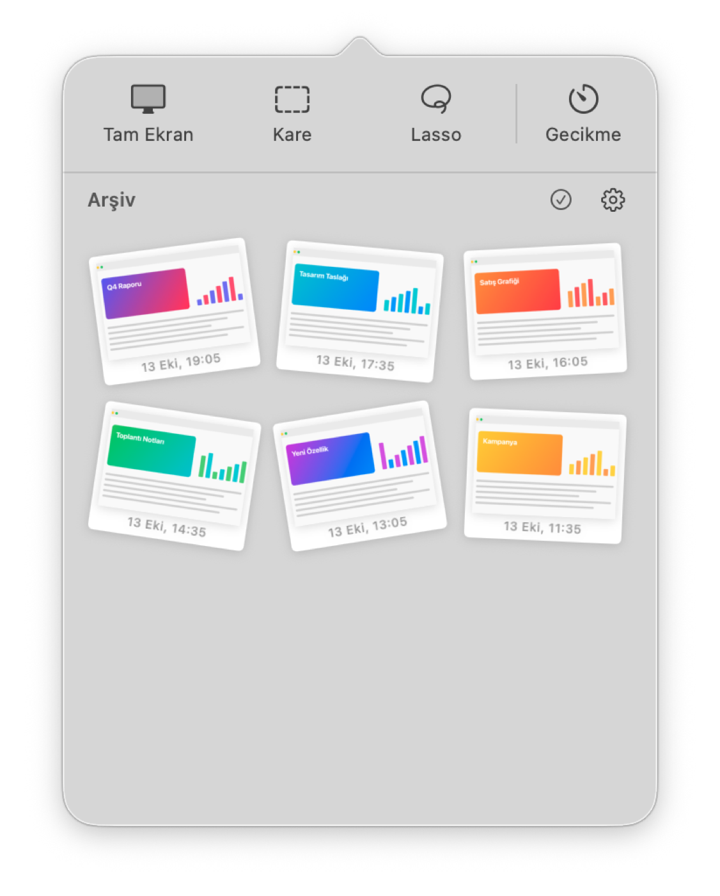

  

<h1 align="center">Elva Screenshot Tool for macOS</h1>

  Mac'iniz için sade ve hızlı bir ekran görüntüsü aracı. 
  Ekranın tamamını ya da istediğiniz bir bölümünü yakalayın, üzerine çizin, yazın, vurgulayın ve arşivinizde saklayın.

  <a href="https://github.com/qokalp/Elva-Screenshot/releases/latest/download/Elva-Screenshot.dmg"><b>⬇︎ Elva'yı İndir (DMG)</b></a>
  &nbsp;·&nbsp; macOS 14 Sonoma veya daha yenisi gerekir

  
  &nbsp;&nbsp;
  

---

## Neler yapabilirsiniz?

- 📸 **Üç farklı çekim:** tüm ekran, kare seçim ya da elle serbest çizerek (lasso) seçim
- ⏱️ **Gecikmeli çekim:** 3, 5 veya 10 saniye sonra otomatik çekim
- ✏️ **Üzerine çizin:** kalem, yazı ve fosforlu kalem (vurgulayıcı)
- 📋 **Tek tıkla paylaşın:** kopyalayın, PNG/JPG olarak kaydedin veya arşivleyin
- 🗂️ **Şık bir arşiv:** tüm ekran görüntüleriniz menü çubuğunda, polaroid fotoğraflar gibi
- ⌨️ **Klavye kısayolları:** menüyü açmadan bile çekim yapın

---

## Kurulum

1. Yukarıdaki **“Elva'yı İndir”** bağlantısına tıklayın.
2. İnen **Elva-Screenshot.dmg** dosyasını çift tıklayarak açın.
3. Açılan pencerede Elva ikonunu **Applications (Uygulamalar)** klasörüne sürükleyin.

   

4. Uygulamalar klasöründen **Elva Screenshot Tool for macOS**'u açın.
   Elva bir menü çubuğu uygulamasıdır: Dock'ta görünmez, ekranın sağ üstündeki menü çubuğunda bir kamera ikonu belirir.

> **“Uygulama açılamıyor” uyarısı görürseniz:** Sistem Ayarları › Gizlilik ve Güvenlik bölümüne gidin, sayfanın altındaki Elva satırında **“Yine de Aç”** düğmesine basın. Bunu yalnızca ilk açılışta bir kez yapmanız gerekir.

### Ekran kaydı izni

Mac, ekran görüntüsü alan her uygulamadan izin ister. İlk çekimde:

1. Çıkan pencerede **Sistem Ayarlarını Aç**'a tıklayın.
2. **Ekran ve Sistem Sesi Kaydı** listesinde Elva'nın yanındaki anahtarı açın.
3. Elva'yı kapatıp yeniden açın (menü çubuğu ikonu › ⚙︎ › Çıkış, sonra Uygulamalar klasöründen tekrar açın).

---

## Kullanım kılavuzu

### Ekran görüntüsü almak

Menü çubuğundaki **kamera ikonuna** tıklayın. Üstte dört düğme göreceksiniz:

| Düğme | Ne yapar? |
|---|---|
| **Tam Ekran** | Farenin bulunduğu ekranın tamamını yakalar. |
| **Kare** | Ekran kararır; fareyle sürükleyerek dikdörtgen bir alan seçin. |
| **Lasso** | Fareyle serbestçe çizerek istediğiniz şekilde bir alan seçin. |
| **Gecikme** | Çekimden önce beklenecek süreyi seçin (Kapalı / 3 / 5 / 10 saniye). Ekranın ortasında geri sayım görünür. |

Seçim yaparken vazgeçmek isterseniz **Esc** tuşuna basın.

### Klavye kısayolları

| Kısayol | İşlem |
|---|---|
| **Control + Shift + 1** | Tam ekran |
| **Control + Shift + 2** | Kare seçim |
| **Control + Shift + 3** | Lasso seçim |

### Düzenleme penceresi

Her çekimden sonra görüntü, altında küçük bir araç çubuğuyla açılır:

| Simge | Ne yapar? |
|---|---|
| ✕ | Pencereyi kapatır (**Esc** de olur) |
| ✏️ Kalem | Serbest çizim |
| Aa Yazı | Görüntüye tıklayın, yazınızı yazın, **Enter**'a basın |
| 🖍️ Vurgulayıcı | Yarı saydam fosforlu kalem. **Shift**'e basılı tutarsanız dümdüz çizgi çizer |
| ● Renk | Renk ve kalınlığı / yazı boyutunu seçin |
| ↶ ↷ | Geri al / yinele |
| ⧉ Kopyala | Görüntüyü panoya kopyalar; istediğiniz yere yapıştırabilirsiniz |
| ⤓ Kaydet | PNG veya JPG olarak bilgisayarınıza kaydeder |
| 🗃️ Arşivle | Görüntüyü Elva arşivine ekler |

Pencereyi taşımak için araç çubuğunun boş bir yerinden tutup sürükleyin.

### Arşiv

Menü çubuğundaki pencerenin alt kısmında arşivlediğiniz tüm görüntüler bulunur.

- Bir görüntünün **üzerine gelin**: büyür ve düzleşir.
- **Tıklayın**: düzenleme penceresinde açılır.
- **Sağ tıklayın**: kopyala, kaydet, Finder'da göster ya da sil.
- Masaüstüne veya bir e-postaya **sürükleyip bırakabilirsiniz**.

**Birden çok görüntüyle çalışmak:** ✓ (Seç) düğmesine basın, görüntüleri seçin. Ardından:

- ✏️ hepsini düzenleme penceresinde açar (araç çubuğundaki ‹ › oklarıyla aralarında gezinirsiniz),
- ⤓ hepsini tek seferde PNG ya da JPG olarak bir klasöre kaydeder,
- 🗑️ seçilenleri siler.

### Ayarlar (⚙︎)

- **Arşiv klasörünü aç:** Arşivlenmiş görüntülerin bulunduğu klasörü gösterir.
- **Oturum açılışında başlat:** Mac'inizi açtığınızda Elva otomatik başlar.
- **Çıkış:** Elva'yı kapatır.

---

## Sık sorulan sorular

**Menü çubuğunda Elva ikonunu göremiyorum.**
Menü çubuğunuz çok doluysa ikon gizlenmiş olabilir. Birkaç başka ikonu kaldırmayı deneyin ya da Elva'yı Uygulamalar klasöründen yeniden açın.

**Ekran görüntüsü yerine boş ya da yalnızca masaüstü görüntüsü çıkıyor.**
Ekran kaydı izni verilmemiş demektir. Yukarıdaki *Ekran kaydı izni* adımlarını uygulayın ve Elva'yı yeniden başlatın.

**Arşivlenen görüntüler nerede duruyor?**
⚙︎ › **Arşiv klasörünü aç** ile görebilirsiniz. Görüntüler yalnızca kendi Mac'inizde saklanır; hiçbir yere gönderilmez.

**Elva'yı nasıl kaldırırım?**
Elva'dan çıkın, Uygulamalar klasöründeki Elva'yı Çöp Sepeti'ne sürükleyin.

---

Geliştiriciler için: kaynak koddan derleme ve proje yapısı [docs/TECHNICAL.md](docs/TECHNICAL.md) dosyasında anlatılıyor.
